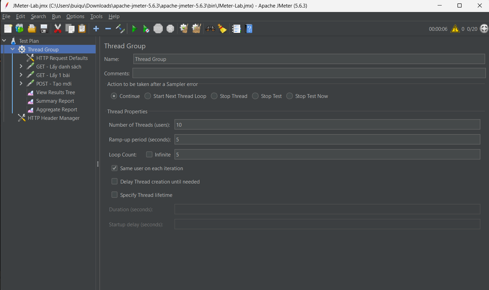
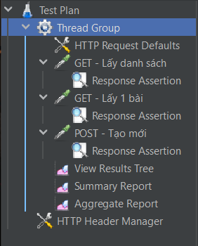

# Báo cáo thực hành kiểm thử hiệu năng bằng JMeter

## Thông tin sinh viên

- **Họ và tên:** Bùi Minh Quân
- **Mã sinh viên:** 23010725
- **Môn học:** Đánh giá và kiểm định chất lượng phần mềm
- **Giảng viên:** Trịnh Thanh Bình
- **Tên dự án:** jmeter-testing-lab

## 1. Mục tiêu

- Làm quen với Apache JMeter và kiểm thử hiệu năng một API.
- Tạo Test Plan gồm Thread Group, HTTP Request, Assertion và Listener.
- Chạy kiểm thử với nhiều người dùng đồng thời và phân tích kết quả (thời gian phản hồi, tỷ lệ lỗi, thông lượng).

## 2. Môi trường

- **Công cụ:** Apache JMeter 5.6.3, Java 17.0.12
- **API kiểm thử:** JSONPlaceholder – https://jsonplaceholder.typicode.com
- **Cấu hình tải:** [số threads] users, ramp-up [x] giây, lặp [x] lần

## 3. Cấu trúc repository

```
.
├── README.md
├── images/                 # Ảnh minh hoạ
├── jmeter/
│   ├── JMeter-Lab.jmx      # Test Plan
│   └── results.jtl         # Kết quả thô
└── report/                 # HTML Dashboard do JMeter tạo
```

## 4. Cấu hình Test Plan

### 4.1. Thread Group



### 4.2. Cây Test Plan

Test Plan gồm: HTTP Header Manager, Thread Group (HTTP Request Defaults, 3 HTTP Request kèm Response Assertion, View Results Tree, Summary Report, Aggregate Report).



### 4.3. Các HTTP Request

| Tên | Method | Path | Kết quả mong đợi |
|---|---|---|---|
| GET - Lấy danh sách | GET | `/posts` | 200 |
| GET - Lấy 1 bài | GET | `/posts/1` | 200 |
| POST - Tạo mới | POST | `/posts` | 201 |

Body của request POST:

```json
{ "title": "Test JMeter", "body": "Noi dung", "userId": 1 }
```


### 4.4. Response Assertion

Mỗi request kiểm tra Response Code bằng giá trị mong đợi ở bảng trên.


## 5. Kết quả thực hiện

### 5.1. View Results Tree


### 5.2. Summary Report


### 5.3. Aggregate Report


### 5.4. HTML Dashboard


### 5.5. Bảng tổng hợp

| Request | Samples | Average (ms) | Median (ms) | 90% Line (ms) | Min (ms) | Max (ms) | Error % | Throughput |
|---|---|---|---|---|---|---|---|---|
| GET - Lấy danh sách | 100 | 150 | 70 | 210 | 49 | 1187 | 0.00% | 16.2/sec |
| GET - Lấy 1 bài | 100 | 53 | 45 | 89 | 34 | 151 | 0.00% | 19.8/sec |
| POST - Tạo mới | 100 | 280 | 273 | 302 | 260 | 363 | 0.00% | 19.0/sec |
| **TOTAL** | 300 | 161 | 77 | 295 | 34 | 1187 | 0.00% | 46.3/sec |

## 6. Phân tích

- **Tỷ lệ thành công:** 300/300 request thành công, Error % = 0.00% ở cả 3 request. Các Response Assertion (200 cho GET, 201 cho POST) đều đạt.
- **Thời gian phản hồi:** trung bình toàn bộ là 161 ms, trung vị 77 ms, 90% request hoàn thành dưới 295 ms. Đây là mức tốt cho một API.
- **Request nhanh nhất:** GET lấy 1 bài (trung bình 53 ms) vì dữ liệu trả về nhỏ.
- **Request chậm nhất:** POST tạo mới (trung bình 280 ms, thấp nhất 260 ms), do phải xử lý thao tác ghi dữ liệu.
- **Giá trị bất thường:** GET lấy danh sách có 95% Line là 859 ms và Max 1187 ms, trong khi trung vị chỉ 70 ms. Một số ít request đầu tiên chậm hơn rõ rệt, có thể do thiết lập kết nối SSL ban đầu và response lớn (100 bài viết).
- **Thông lượng:** hệ thống xử lý khoảng 46.3 request/giây.

## 7. Khó khăn và cách khắc phục

- [Ghi lỗi thật bạn gặp, ví dụ: ban đầu chưa điền Server Name trong HTTP Request Defaults nên request lỗi; đã bổ sung `jsonplaceholder.typicode.com`.]
- [Nếu không gặp lỗi gì, ghi khó khăn khi làm quen giao diện JMeter hoặc khi xuất HTML report.]

## 8. Kết luận

API JSONPlaceholder chịu được tải kiểm thử tốt: không có lỗi, thời gian phản hồi thấp và ổn định, chỉ xuất hiện một vài request chậm ở các lần gọi đầu. Kết quả chỉ phản ánh mức tải nhỏ của bài thực hành, chưa đại diện cho tải thực tế lớn.

## 9. Tài liệu tham khảo

- Apache JMeter: https://jmeter.apache.org
- JSONPlaceholder: https://jsonplaceholder.typicode.com
